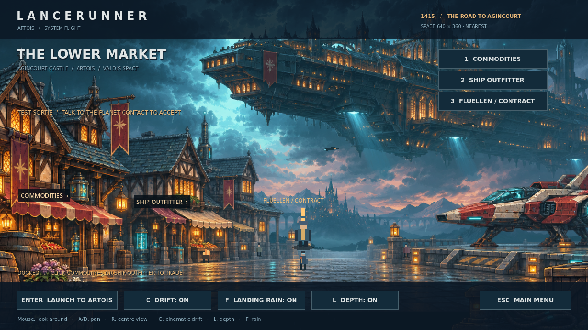
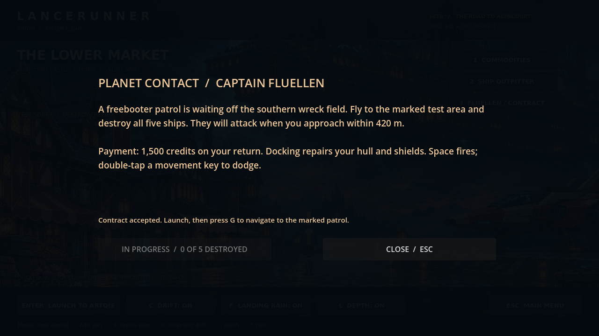
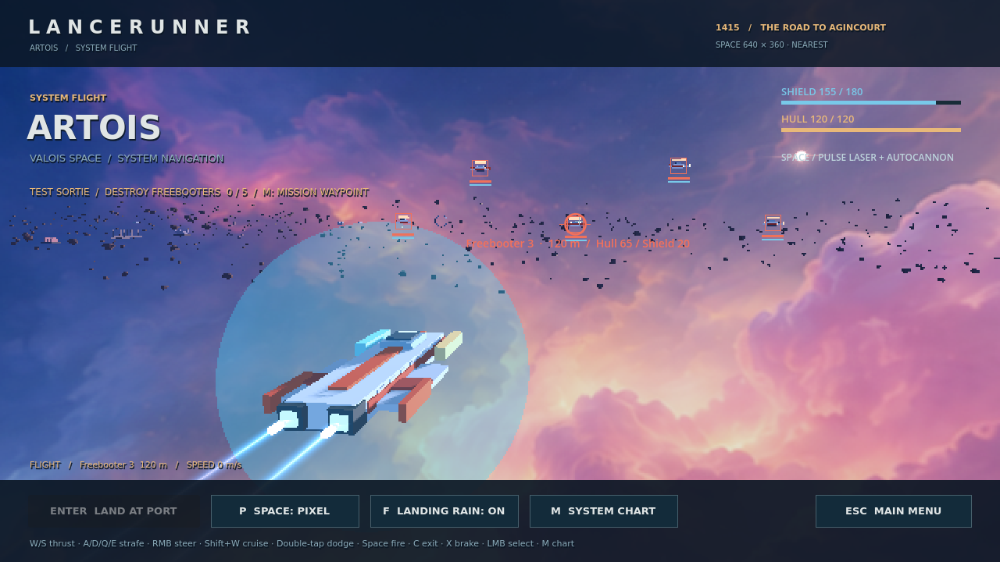

# Artois combat test sortie

Open **ARTOIS SYSTEM / EXPLORE**. Approach Agincourt Planet Port and press Enter
(within 90 m, under 20 m/s), or use G to navigate there first.

On the planet, click the blue-coated **Fluellen** contact beside the market
(identified by a gold !), click **3 FLUELLEN / CONTRACT**, or press **3**.
Accept the test sortie, close the conversation and launch with Enter.
**G** follows the selected mission waypoint; **M** also lists and marks the site.
Five freebooters wait there and start attacking when approached within **420 m**.

Use right mouse drag to steer, left click an enemy to track it, **T** to align,
and **Space** to fire fitted guns toward the cursor within a 30-degree forward
arc. **Z** selects missile ammunition and **F** launches after a 1.5-second lock. Destroy all five, then **G** navigates to the automatically selected
planet port. Land, speak to Fluellen and claim **1,500 credits**. Payment uses the
existing atomic market save and cannot be claimed twice for the same sortie.
You can explicitly repeat the test after payment.

## Dodge and defence

Double-tap the same movement key within **0.27 seconds**:

| Keys | Burst direction |
| --- | --- |
| AA / DD | Left / right |
| WW / SS | Forward / backward |
| QQ / EE | Down / up |

Directions follow the ship's orientation. The burst starts at 135 m/s and decays
quickly, adding roughly 22.5 m of displacement. A 0.65-second cooldown prevents
stacking bursts. A dodge cancels cruise and course following. Holding a key or
keyboard auto-repeat never counts as a double-tap. Chart, shop and conversation
input does not trigger flight dodges. Shift+W still engages cruise at five times
normal speed, with weapons locked; C or X exits cruise.

The HUD shows hull, shields, fitted guns and the mission kill count. Hostiles have
red brackets and hull/shield bars. Shields absorb hits before hull. The starter
ship has **120 hull / 60 shield**; shields regenerate at 8 per second after four
seconds without damage. The **Aegis** utility increases shield capacity to **180**
and recharge to **22 per second**. Docking repairs the ship for this prototype.
If destroyed, the ship is recovered to the repaired planet hub, the active sortie
fails, and the contact offers a clean retry without a reward.

## Live equipment

The outfitter's existing saved loadout drives Artois combat when the shop closes
and on launch. Two visible gun mounts reflect the fitted weapon slots; empty
slots do not fire. Removing Aegis restores the standard built-in shield.

| Weapon | Damage | Interval | Projectile speed |
| --- | --- | --- | --- |
| Lance pulse laser | 48 | 0.38 s | 125 m/s |
| Longbow autocannon | 24 | 0.16 s | 165 m/s |
| Falcon missile rack | By ammunition | 1.2 s | 160–220 m/s |

Missiles steer toward the locked hostile after launch and consume purchased
Pavise, Bodkin or Fetter rounds. Recovery supplies restore hull or shields.
See [ordnance and supplies](artois-ordnance.md) for controls, effects and prices. Fast rounds use segment/sphere sweeps to avoid tunnelling. Each
hostile starts with 65 hull and 20 shield, manoeuvres to maintain firing distance,
and fires damaging, dodgeable projectiles. Hits flash the player's shield and
destroyed fighters produce a brief expanding burst.

## Scope and implementation

This is a repeatable combat slice in Artois. The contract, enemy state and kill
count last for the current Artois session; leaving for the menu or quitting resets
them. Credits, cargo and equipment still persist. The map's other stations and
asteroids remain navigation blockouts without damage or physical collision.
Projectiles currently collide with combat ships, not the environment. Enemy AI
is a simple approach/retreat behaviour, not a full squadron or traffic simulation.
The original visual benchmark and original combat missions keep their mechanics.

- `artois_combat.gd`: fitted guns, shields, projectile sweeps, patrol and damage.
- `artois_sortie.gd`: acceptance, kill counting, completion, reward and retry.
- `artois_contract_panel.gd`: planet contact conversation and actions.
- `artois_contact.gd`: original pixel placeholder for the contact.
- `artois_space.gd`: movement and double-tap bursts.
- `artois_scene.gd`: input, market loadout, contact hotspot and recovery flow.

## Checks

```sh
godot --headless --path . --script res://tests/artois_combat_smoke.gd
godot --headless --path . --script res://tests/artois_smoke.gd
```

The combat test isolates its economy save. It checks real key events, all dodge
axes, cooldown/auto-repeat, fitted guns, shield spillover and recharge, cruise
weapon locking, acceptance, waiting/attacking enemies, selectable hostiles,
projectile kills, objective completion, payment persistence, missile guidance and
defeat/retry. A rendered run also clicks the contact and acceptance controls:

```sh
godot --path . --script res://tests/artois_combat_smoke.gd -- \
  --capture-dir=/absolute/path/to/captures
```

Verified with Godot 4.6.3, headless and rendered OpenGL Compatibility. Forward+,
Godot 4.7 and target hardware performance remain unverified.







See [knightly combat](knightly-combat.md) for cruise spool, energy, armour, active shield and scanner updates.
