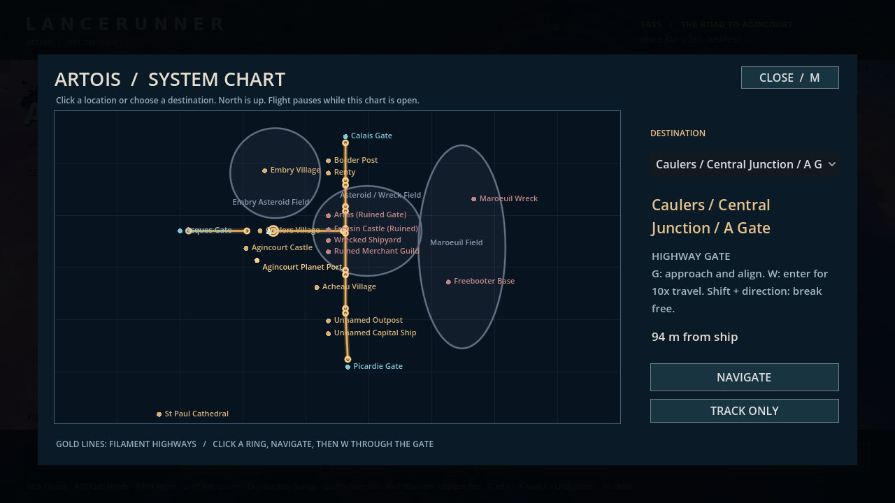
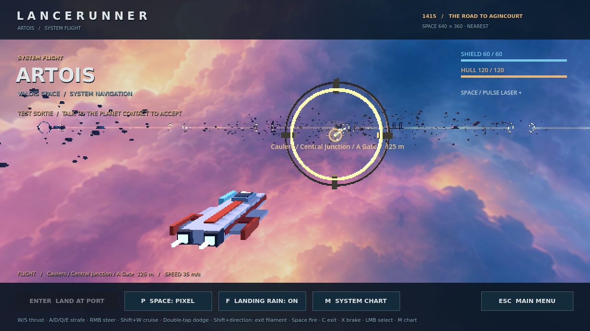
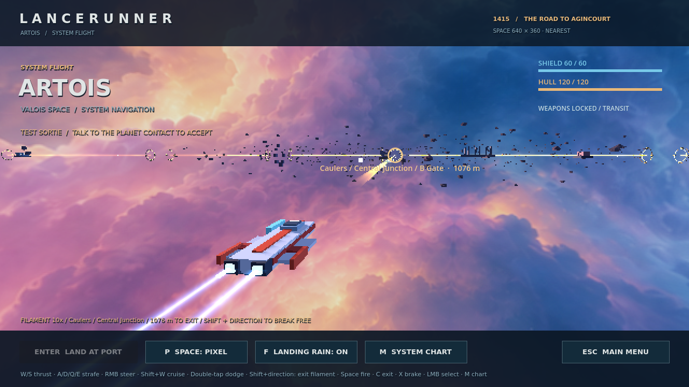
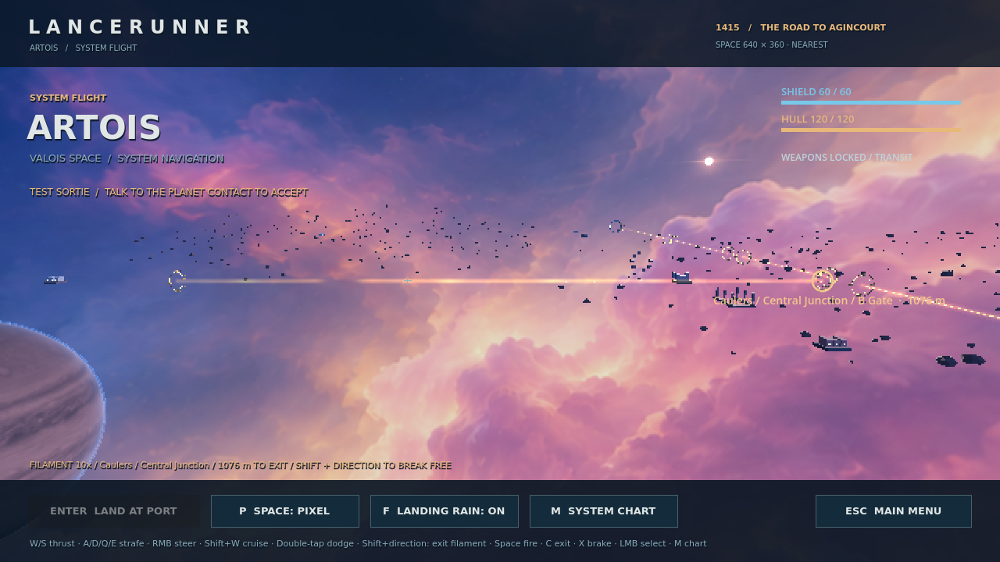
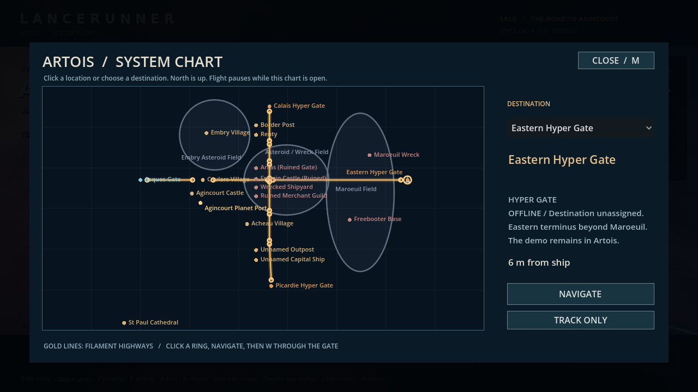
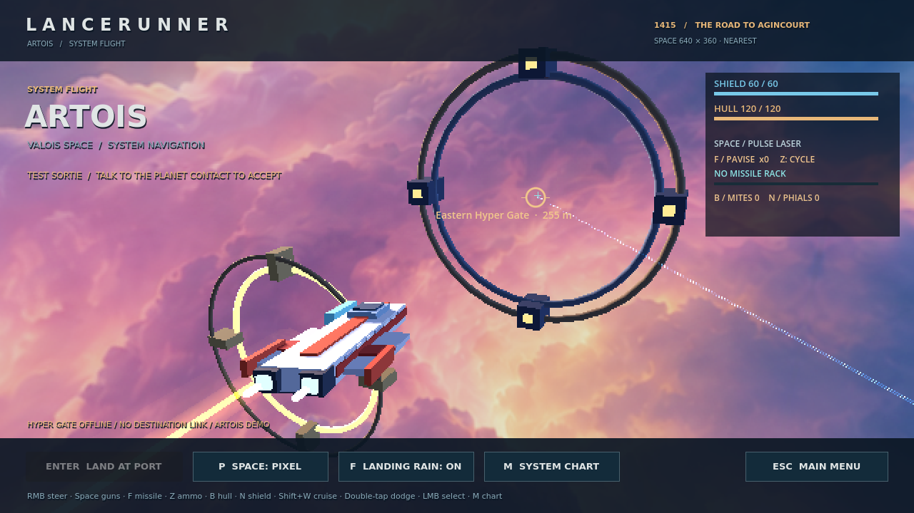

# Golden filament highways

Artois has **nine bidirectional highway links**, with eighteen golden entry rings.
They follow the map's north–south spine and its western Asques/Caulers branch, plus the eastern hyper-gate approach.
The existing blue system-exit gate placeholders remain separate landmarks.

## Ride a filament

1. Press **M** and select a golden ring, or choose a highway gate in the destination list.
2. Choose **NAVIGATE** (or close the chart and press **G**). The ship stops outside that entrance, facing along its filament.
3. Fly **W** through the open ring. Crossing within 18 m of its centre captures the ship.
4. The filament pulls the ship toward its centreline and accelerates it to **350 m/s**, ten times ordinary thrust speed.
5. At the far ring, the ship clears the exit and returns to normal flight at 35 m/s. Hold W to continue toward the next ring, or turn toward the nearby settlement.

To leave early, **hold Tab plus a movement direction** (W/S/A/D/Q/E), or
**double-tap a movement key** for a directional dodge. The boost breaks the pull,
adds an escape impulse and briefly prevents recapture. **Shift+W breaks out while
attached**; in ordinary flight it still engages cruise. Releasing boost restores
normal control. Rejoining requires entering a gate again; touching a filament
halfway along it does not capture the ship.

Normal steering is possible but resisted by a damped magnetic spring. RMB can
steer the ship while the stream gradually aligns it along the route. Braking or
pressing C does not turn off the magnetic field. Boosting is the escape mechanic.
Weapons and docking are unavailable during transit. Opening the chart pauses
travel, and chart/shop/conversation input cannot trigger a breakout. Death
recovery and launch clear any attached highway state.

## Routes

| Link | Region |
| --- | --- |
| Calais / Renty | Northern gate approach and border settlements |
| Renty / Arras | Approach to the central wreck field |
| Arras / Central Junction | Northern half of the central spine |
| Central Junction / Acheau | Southern half of the central spine |
| Acheau / Southern Post | Southern settlements |
| Southern Post / Picardie | Southern system-exit approach |
| Asques / Caulers | Western branch |
| Caulers / Central Junction | Western branch into the main spine |
| Central Junction / East Hyper Gate | Eastern branch through Maroeuil to its dormant terminus |

There is clearance between each pair of adjoining links, with a larger local
space around Caulers. These are editable placements interpreted from the map;
they do not move the original stations, fields or jump-gate landmarks. Travelling
in the reverse direction works through the opposite entrance of each link.

## Code and visuals

- `data/artois.json` contains each highway's ID, name and endpoint map coordinates.
- `artois_layout.gd` derives eighteen highway navigation targets from that data.
- `artois_highways.gd` builds ring geometry, layered filaments and moving motes,
  detects swept gate crossings, integrates the magnetic spring and handles exits.
- `shaders/artois/filament.gdshader` adds golden light, moving pulses and soft haze.
  A local fade keeps the nearby filament from covering the chase-camera ship.
- The existing Artois flight, chart, click selection, HUD and combat modules
  expose highway travel and preserve ordinary flight outside it.

The chart now lists 41 standard targets (20 locations, three fields,
18 highway gates), plus the test mission waypoint after acceptance. No external
art is required for this first procedural version. Forward+ can add bloom; the
emissive rings and additive filament effects also work in Compatibility.

The highway is a first playable transport slice. It does not yet have NPC traffic,
interdiction, route damage or environment collision. Asteroid and station geometry
remains a blockout as described in the system and combat guides.

## Validation

```sh
godot --headless --path . --script res://tests/artois_highways_smoke.gd
godot --path . --script res://tests/artois_highways_smoke.gd -- \
  --capture-dir=/absolute/path/to/captures
```

The tests traverse all links in both directions, verify 10× speed, swept capture
at cruise speed, missed-ring and midstream non-capture, magnetic centring,
steering resistance, automatic arrival, boost/dodge breakout, recapture delay,
weapons locking, chart pausing and navigation to an aligned approach point.
Rendered tests click chart and space gates and capture the shader effects.
Existing Artois and combat/mission suites also pass. Validation uses Godot 4.6.3
headless and rendered OpenGL Compatibility; Godot 4.7, Forward+ and target hardware
performance remain unverified.










## Dormant hyper gates

Calais (north), Eastern Hyper Gate (east) and Picardie (south) are larger,
non-operational system-exit frames. Each has `destination: null` and
`enabled: false` in `data/artois.json`. The eastern terminus sits beyond Maroeuil
and has a filament connection to the central junction. The Asques branch stays
in place as authored.

These hyper gates can be selected and approached, but have no travel action,
portal trigger or destination scene. Near one, Enter explains **HYPER GATE
OFFLINE / NO DESTINATION LINK / ARTOIS DEMO**. Flying through it does nothing.
Only Agincourt Planet Port still opens the planet landing scene; the playable
demo stays in Artois.

```sh
godot --headless --path . --script res://tests/artois_hyper_gates_smoke.gd
```

Checks verify all three null links, directions, geometry, inert interaction and
crossing, the chart entries and the eastern filament connection.





See [knightly combat](knightly-combat.md) for cruise spool, energy, armour, active shield and scanner updates.
