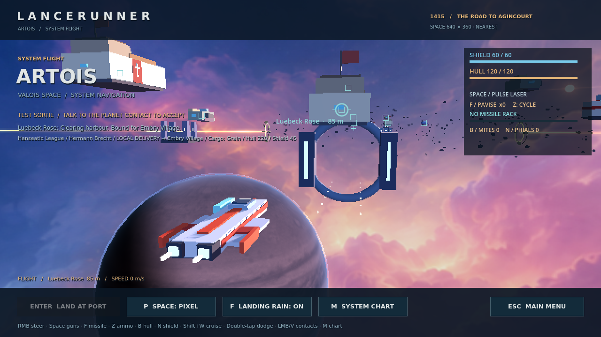
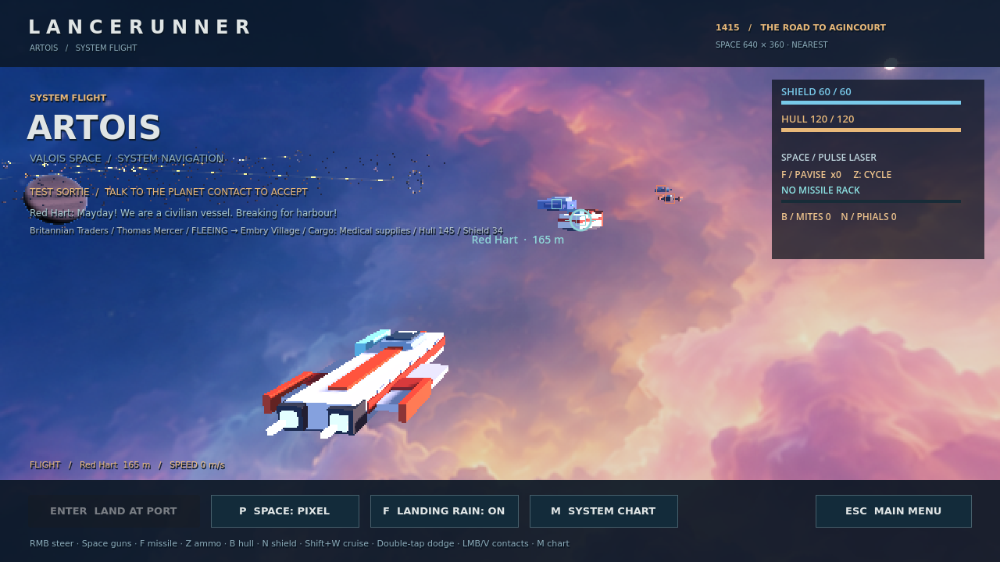

# Artois local population

Artois begins with a finite roster of **30 local ships**, separate from the five
ships spawned by Fluellen's test contract. The world starts populated when
choosing **ARTOIS SYSTEM / EXPLORE**; no mission acceptance is required.

| Group | Ships | Public behaviour |
| --- | --- | --- |
| Hanseatic League | 6 | Heavy merchant cogs making bulk deliveries |
| Britannian Traders | 5 | Civilian trading ships serving the northern settlements |
| Valois Traders | 5 | Civilian traders serving southern/eastern connections and local ports |
| Borderlanders | 8 | Five independent hauliers and three salvage crews |
| Freebooters | 4 | Pirates prowling Maroeuil and hunting vulnerable traffic |
| Unidentified Raiders | 2 | Unmarked fighters making selective attacks on Britannian/Hanseatic traffic |

The raiders' internal story allegiance is Valois military, but their target info,
pilot designation and radio messages do not reveal it. Legitimate Valois traders
remain civilians. The reason for the system closure is deliberately undecided.
Hyper gates remain unlinked; all routines take place inside Artois.

## See what a ship is doing

**Left click** a visible ship to select it, or press **V** to cycle contacts within
1,800 m. The selected contact shows its ship name, pilot, public faction, role,
current state, destination, cargo description, hull and shields. Nearby locals
have small cyan brackets; pirates and raiders use orange/red brackets.

The radio text line reports relevant departures, berth arrivals, salvage and
nearby attacks. Messages are limited in frequency and range; they are text, not
recorded voices. The same callsign belongs to the same ship throughout a session.

## Routines and interactions

- Traders depart from a local harbour, follow a planned route, unload at their
  destination for 10–20 seconds, then begin another delivery. Docked ships are
  hidden at their berth; their identity and state remain alive.
- Routes use the authored golden filament network where it is useful, with
  ordinary flight between ports and entrances. NPCs visibly pass through the
  rings and use 350 m/s filament legs, returning to local speed at exits.
- Salvagers visit ruined shipyards, guild wrecks and the Maroeuil wreck. They hold
  visibly on site to recover scrap, then travel to a surviving port to unload.
- Freebooters and raiders prowl their home areas and select nearby prey. Raiders
  favour Britannian/Hanseatic traffic. At most two opportunistic attacks are
  assigned at once; a ship provoked by the player can still defend itself.
- Civilians boost away from attackers, send distress messages and resume their
  existing delivery after escaping. Pirate/raider shots can hit other NPCs and
  the player. Destroyed ships explode and stay destroyed for the session.
- Player guns can hit any visible local hull. Attacking a civilian makes it flee
  and protest; hostile locals retaliate. Existing seeker locks, missile damage
  profiles and Fetter disruption work against local hostiles.

Local kills do **not** count toward the separate five-enemy test mission.
Accepting/retrying that contract does not reset local traffic. Population does
not grow or instantly respawn replacements after a kill.

Routines continue while visiting the planet, including while a shop/contact is
open. The player ship is excluded as a target during landing/planet visits.
Opening the space chart still pauses flight and traffic together.

## Scope

This is a small playable population, not the later fleet-scale simulation.
Distance-based simulation tiers and billboards remain parked. All thirty records
have ordinary kinematic routines; local separation is a steering aid, not full
rigid-body ship collision or obstacle routing. The hulls are original procedural
low-poly placeholders inspired by the supplied cog and Britannian references,
with distinct silhouettes/colours and shared mesh resources for each group.
They can be replaced with authored assets later.

Cargo and deliveries describe routines; they do not change market prices or
station inventory. There is no NPC cargo trading UI, surrender transaction,
reputation system or loot economy in this pass. Existing player inventory saves
remain separate. Local position, health and routine progress persist through
planet visits, but reset when leaving Artois or quitting.

## Content and code

- `data/artois_population.json`: population cap, faction profiles, name pools,
  callsigns, home ports, route choices, cargo descriptions and ship stats.
- `artois_local_models.gd`: shared original meshes for cogs, national traders,
  patched Borderlander ships, freebooters and unmarked raiders.
- `artois_traffic_routes.gd`: route graph and travel-time planning across the
  filament network, plus local harbour legs.
- `artois_traffic.gd`: stable actor records, routines, threat selection, civilian
  escape, local projectiles/damage and contextual radio text.
- Existing Artois flight, combat, selection and HUD modules expose local ships
  without turning them into quest enemies or resetting them on launch.

For exports, include **`data/*.json`** as non-resource files so both the system
layout and population content are packaged.

## Validation

```sh
godot --headless --path . --script res://tests/artois_traffic_smoke.gd
godot --path . --script res://tests/artois_traffic_smoke.gd -- \
  --capture-dir=/absolute/path/to/captures
```

Checks cover roster limits/factions, unique callsigns, identity continuity,
filament route planning, real delivery/berth/departure and salvage cycles,
raider target selectivity/public identity, NPC-to-NPC projectile damage and
civilian escape, player combat, disruption, no automatic respawn, contract
isolation and continued routines during a planet conversation. Rendered checks
exercise clicking and V contacts. Existing flight, combat/mission, ordnance,
highway and dormant-hyper-gate checks also pass.

Verified with Godot 4.6.3, headless and rendered OpenGL Compatibility. Forward+,
Godot 4.7, target hardware performance and large fleet scale remain unverified.




