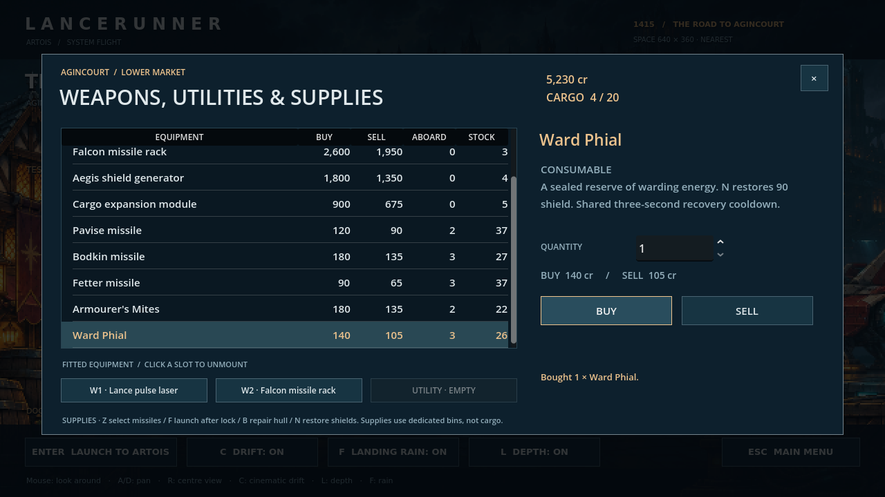
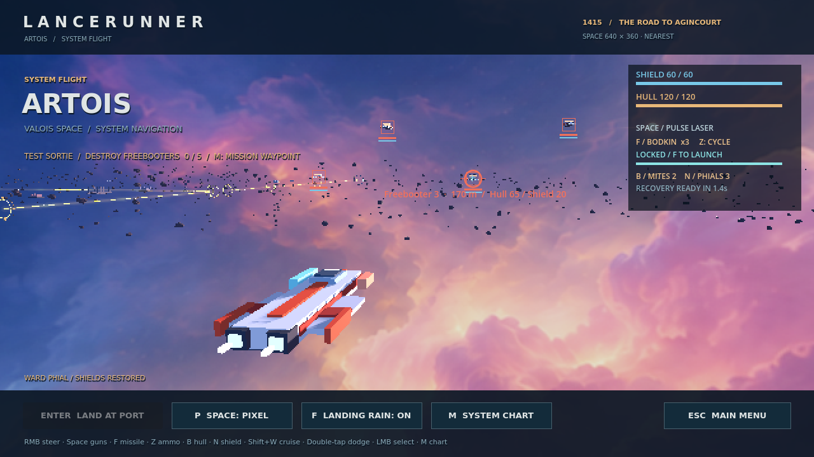

# Cursor guns, seekers and recovery supplies

Artois combat now uses cursor-directed guns, missile ammunition and purchased
recovery supplies. Buy supplies from **SHIP OUTFITTER** on the planet. They are
stored in dedicated bins (up to 99 of each type), outside the commodity hold.
They do not need fitting. The Falcon launcher still occupies a weapon hardpoint.

## Controls

| Control | Action |
| --- | --- |
| Move cursor + Space | Fire fitted guns at the cursor, limited to a 30° cone around the ship's nose |
| Left click | Select a target; it does not fire |
| Right mouse drag | Steer the ship to bring targets inside the gun/seeker arcs |
| Z | Cycle Pavise / Bodkin / Fetter ammunition |
| F | Launch one selected missile after acquiring a lock |
| B | Use Armourer's Mites to restore hull |
| N | Use a Ward Phial to restore shields |

The gun reticle shows the actual aim point. It turns amber when the requested
cursor aim exceeds the gimbal limit. Both barrels turn toward the aim point, and
neither can fire sideways or backwards. Cursor mapping accounts for pixel/native
rendering, viewport cropping and window scaling. The cursor ray intersects a
plane at the selected hostile's depth, or at 350 m without a hostile selected.
Guns retain their projectile travel time and existing range/lifetime limits.

## Missile lock and damage

Fit a **Falcon missile rack**, select an enemy, and hold it within **20° of the
nose** and **600 m** for **1.5 seconds**. The HUD shows acquisition progress and
**LOCKED / F TO LAUNCH**. Lock resets when changing target or ammunition, leaving
the seeker cone/range, losing the target, entering cruise/highway transit, or
when the planet blocks line of sight. Missiles cannot launch during transit.

F launches a single homing round with a 1.2-second launcher cooldown. Space fires
only guns, so it cannot accidentally waste missiles. A valid lock and successful
inventory save are required before ammunition is spent. In-flight seekers follow
their original target; if it is destroyed, the round continues without retargeting.

| Ammunition | Buy / sell | Dealer stock | Shield / hull damage | Role |
| --- | --- | --- | --- | --- |
| Pavise missile | 120 / 90 cr | 40 | 90 / 6 | Strip shields |
| Bodkin missile | 180 / 135 cr | 30 | 8 / 80 | Strike exposed hull |
| Fetter missile | 90 / 65 cr | 40 | 12 / 5 | Interrupt cruise and slow the target |

Shields intercept missiles. Hull damage is applied only for the fraction of a hit
left after shields are depleted; Bodkin rounds do not bypass intact shields.
The missile types have distinct light colours and projectile speeds.

A Fetter hit immediately cancels cruise and caps movement at **12 m/s for six
seconds**, including boost/dodge attempts. Cruise cannot be restarted during that
period. The same effect works against the player and patrol enemies. A player hit
also releases a highway capture. Patrol fighters can use short cruise approaches
from beyond 300 m; Fetter rounds interrupt those approaches and slow ordinary
flight too. The test patrol still fires its existing guns rather than missiles.

## Recovery supplies

| Supply | Buy / sell | Dealer stock | Effect |
| --- | --- | --- | --- |
| Armourer's Mites | 180 / 135 cr | 25 | Tiny repair servitors restore 60 hull |
| Ward Phial | 140 / 105 cr | 30 | A sealed energy reserve restores 90 shield |

B and N share a **three-second cooldown**. Restoration is capped at the ship's
maximum; nothing is spent when the relevant bar is already full, the bin is empty,
the ship is destroyed or recovery is cooling down. Supplies can be used in flight,
including cruise. Shop/chart/conversation controls do not activate them. Normal
shield regeneration and the Aegis upgrade continue to work.

These are initial balance prices against the test sortie's 1,500-credit reward.
Ordinary guns use no consumable ammunition. Existing saves keep their credits,
cargo and loadout, gain the new dealer stock, and receive no free player supplies.
Buying, selling and consumption use the existing atomic economy save. A failed
consumption save restores the unit to inventory and prevents its effect/launch.

## Implementation and checks

`artois_ordnance.gd` owns cursor gimbals, seeker acquisition, ammunition selection
and supply use. `artois_combat.gd` handles actual projectile guidance, specialised
hits and enemy disruption. The flight controller applies player disruption;
the shared landing market owns stock, prices, validation and persistence.
The original combat missions and visual benchmark keep their separate mechanics.

```sh
godot --headless --path . --script res://tests/artois_ordnance_smoke.gd
godot --path . --script res://tests/artois_ordnance_smoke.gd -- \
  --capture-dir=/absolute/path/to/captures
```

Checks cover gun trajectories/cone limits, lock acquisition/loss/range, guided
hits, all three damage profiles, player/enemy cruise cancellation and recovery,
ammunition persistence, consumable caps/cooldowns, full-bar non-consumption,
save-failure rollback, old-save migration, shop purchases and actual F/Z keys.
Rendered checks cover mouse aiming, pixel/native projection and shop UI.
Existing Artois, mission/combat, highway and market checks are also run.
Verification uses Godot 4.6.3 and rendered OpenGL Compatibility; Forward+, Godot
4.7 and target hardware performance remain unverified.




