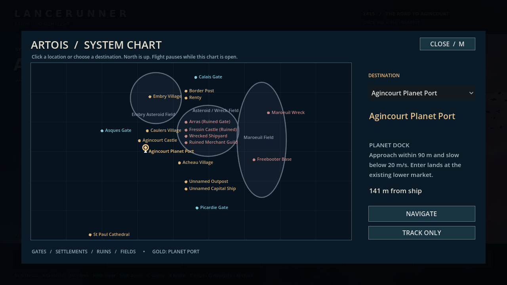
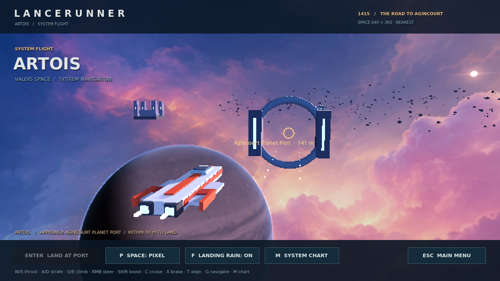
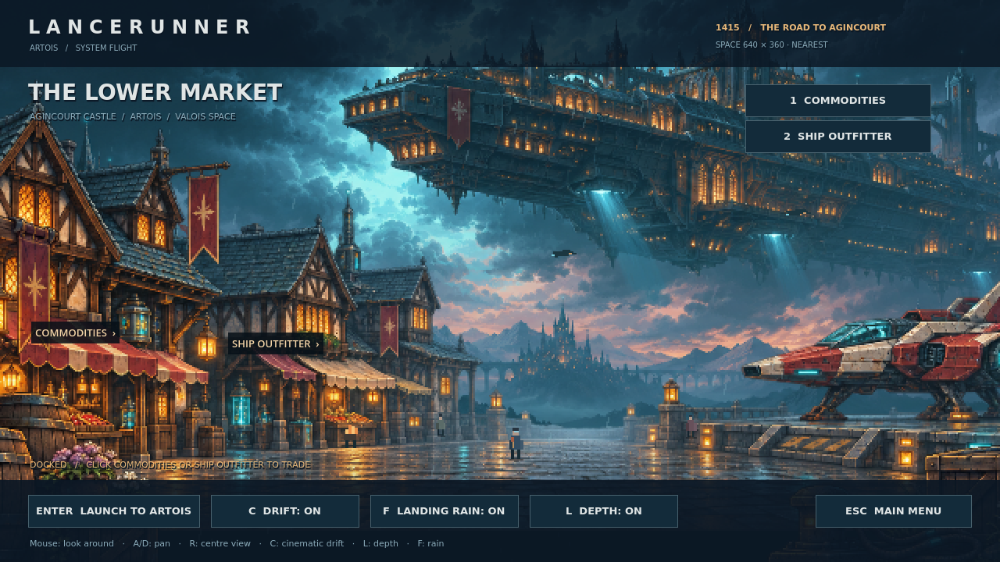

# Artois system blockout

A separate playable system scene built from the visual benchmark's environment,
ship, materials and effects. It preserves the authored map's north/south layout,
adds an orbital planet port near Agincourt, and connects that port to the existing
2.5D landing market. The original visual benchmark and combat missions remain
available from the menu.

## Play

Choose **ARTOIS SYSTEM / EXPLORE** on the main menu. Alternatively open
`scenes/artois.tscn` in Godot and press F6.

The ship starts 141 m from **Agincourt Planet Port**, facing its approach. Press
**G** to follow a course toward it, or fly forward and brake manually. Once within
**90 m** and below **20 m/s**, press **Enter** or the landing button. The screen
fades into `scenes/planet_landing.tscn`, including its parallax, weather and both
market shops. **Enter** launches back into the same Artois world, just outside
docking range. Cargo, credits and prototype loadout use the existing saved market
profile. An open shop blocks launch.

## Flight and navigation

| Control | Action |
| --- | --- |
| W / S | Forward / reverse thrust |
| A / D | Strafe |
| Q / E | Descend / climb along the ship's local up axis |
| Right mouse drag | Steer yaw and pitch |
| Shift | Boost |
| Shift + W | Engage latched forward cruise at 175 m/s (5× normal); weapons locked |
| C | Toggle cruise off/on |
| Left click | Select a structure, wreck or planet; a rock selects its asteroid field |
| X | Brake immediately and cancel cruise/course following |
| Space | Fire cursor-directed guns within a 30° forward arc (disabled in transit) |
| Z / F | Select missile type / launch after 1.5-second lock |
| B / N | Use Armourer's Mites for hull / Ward Phial for shields |
| Double-tap W/S/A/D/Q/E | Dodge in that local direction; 0.65-second cooldown |
| 3 (landed) | Talk to Fluellen for the five-enemy test sortie |
| M | Open/close the system chart; flight pauses while it is open |
| Tab | Cycle tracked destinations |
| T | Align the ship toward the tracked destination |
| G | Navigate toward the tracked destination and stop short of it |
| Enter | Land at the planet port when range/speed permit; launch when landed |
| P | Compare pixel/native space rendering |
| R | Snap the chase camera back into position |
| Esc | Close a chart/shop first, otherwise return to the menu |

The chart lists **38 navigation targets**, including sixteen highway entrances. Click a location on the chart or use
the destination picker, then **NAVIGATE** to engage course following. **TRACK
ONLY** keeps the marker for manual flight. Asteroid field centres can also be
selected. Manual thrust/strafe/steering cancels course following. Normal thrust
is 35 m/s, boost 105 m/s, cruise 175 m/s and automatic course speed up to 280 m/s, with acceleration
and braking. Cruise stays engaged after releasing Shift+W; C or X exits it.
Space selection respects UI panels and the planet obscuring objects behind it.
Course following is simple point-to-point navigation, not an AI
traffic or obstacle-routing system.

The new flight controller has no old benchmark movement box. Planet penetration
is prevented by an analytic sphere boundary. Placeholder stations, ships and
asteroids do not yet supply collision/damage gameplay. Jump gates are visible
navigation landmarks; travel to other systems is not implemented here. Only the
planet port opens a landing destination in this first pass.

Fitted weapons, regenerating shields and the planet contact's repeatable
five-enemy test mission are described in [Artois combat](artois-combat.md).

Golden filaments connect the main north–south route and western branch. Fly
through a ring for 10× travel; Shift plus a direction breaks the magnetic pull.
See [highway controls and routes](artois-highways.md).

## Included map elements

| Region | Placeholders |
| --- | --- |
| North | Calais Gate, Border Post, Renty |
| Embry field | Embry Village and its elliptical asteroid volume |
| West | Asques Gate, Caulers Village, Agincourt Castle |
| Central wreck field | Arras ruined planet gate, ruined Fressin Castle, wrecked shipyard, ruined merchant guild |
| Maroeuil field | Long asteroid volume, northern ship wreck and southern freebooter base |
| South | Acheau Village, unnamed outpost, unnamed capital ship, Picardie Gate |
| Southwest | St Paul Cathedral |
| Added planet access | Agincourt Planet Port and a visible planet with atmosphere |

The two unfinished southern map labels remain named **Southern Outpost
(Unnamed)** and **Southern Capital Ship (Unnamed)**. Their notes retain the
latest map's working labels (`sdfsdfsdf` and `sdfsdf`); the earlier drawing
identified a capital ship in the second position. These names are not final
story decisions. The castle's later battle is not scripted.

## Layout and code

- `data/artois.json`: canonical IDs, names, map positions, notes, planet and fields.
- `artois_layout.gd`: one coordinate conversion used by the chart and world.
- `artois_placeholders.gd`: reusable geometry for gates, settlements, ruins, ships and cathedral.
- `artois_space.gd`: world assembly, free flight, course following and port checks.
- `artois_chart.gd`: selectable chart and course controls.
- `artois_target_hud.gd`: tracked marker, distance and off-screen direction.
- `artois_picking.gd`: nearest-object ray selection for structures, planet and instanced rocks.
- `artois_scene.gd`: system UI, gated docking and landing/launch orchestration.

The layout uses a 1068×807 authoring canvas, with east mapped to +X and south to
+Z, at eight world metres per map pixel. The world builds placeholders from this
data when the scene runs. To move a location, edit its `map: [x, y]` values;
the chart follows automatically. Field `radii` describe the same chart ellipses
used for their 3D asteroid clouds. Counts are 220 Embry, 260 central and 300
Maroeuil rocks, rendered as three instanced mesh groups. The planet body's
position is framed separately from the port so it is visible beyond the approach.

The benchmark now exposes small world/landing factories and a world-build hook.
Artois reuses those instead of copying the entire visual controller. Landing is a
separate scene resource shown in its 2D viewport through the existing fade; the
3D system stays allocated, paused and hidden, preserving state for launch. Old
projectiles and exhaust trails are cleared on launch so they cannot join across
the transition. When configuring an export, include `data/artois.json` among the
non-resource data files.

## Validation and previews

```sh
godot --headless --path . --editor --import --quit
godot --headless --path . --script res://tests/artois_smoke.gd
```

For actual GUI map clicks and rendered captures:

```sh
godot --path . --script res://tests/artois_smoke.gd -- \\
  --capture-dir=/absolute/path/to/captures
```

Checks cover all map IDs, field membership, world/chart agreement, travel beyond
the old bounds, both cruise key orders, exact 5× speed, cruise weapon locking,
rendered object clicks in pixel/native modes, chart input isolation, course arrival, planet exclusion, range/speed-gated
docking, landing shops, launch state cleanup and the menu entry. Existing visual,
market-state and combat component checks also pass. Rendered verification uses
Godot 4.6.3 on Mesa llvmpipe/OpenGL Compatibility. Godot 4.7, Forward+ and target
hardware performance remain unverified.






