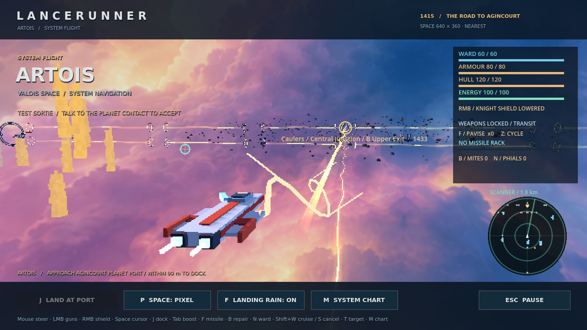
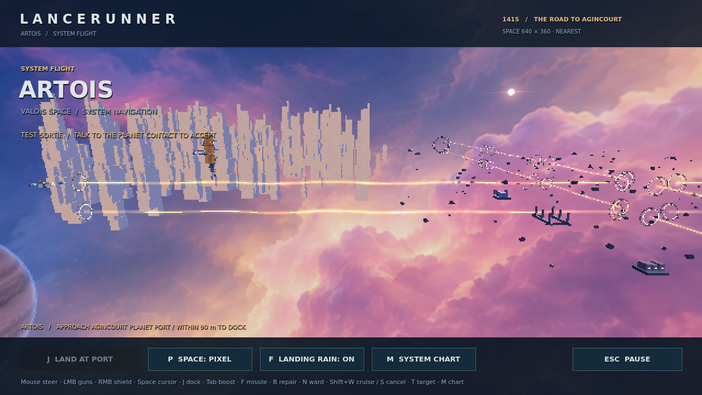
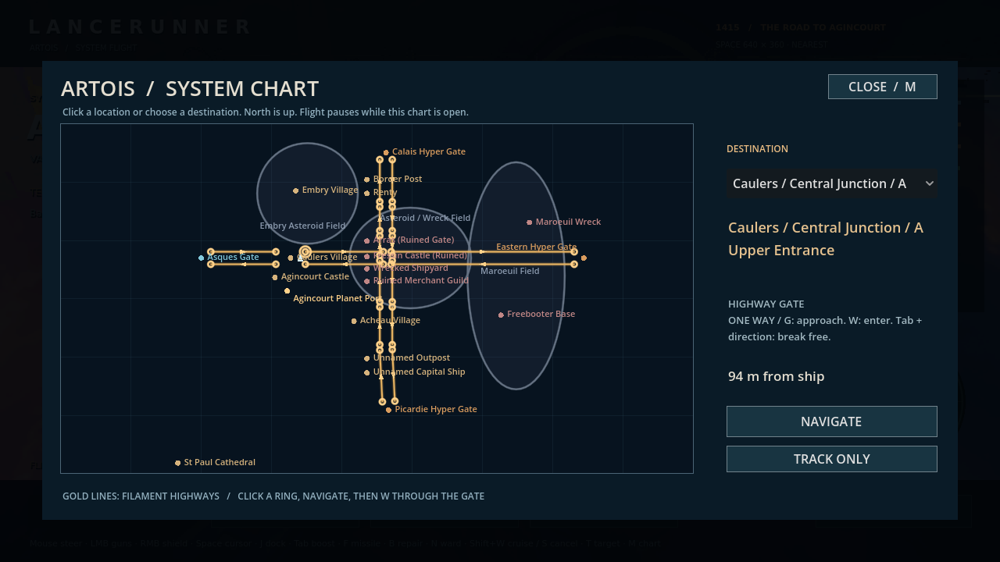

# Directional filament lanes

Each of Artois's nine authored links now has two one-way streams. The upper lane
(+40 m) goes A to B; the lower lane (-40 m) goes B to A. Each endpoint has a gold
entrance and a cool-coloured exit, 80 m apart vertically: 36 rings in total.
The existing `_a` and `_b` IDs remain entrances; `_a_exit` and `_b_exit` identify
outbound rings. Exits do not capture in either direction. Chart markers are
separated schematically beside each route, with arrows and explicit Entrance/Exit names.

The gold streams weave gently with layered sine curves. They stay 80 m apart,
and the weave tapers to zero at every ring. The shader, motes and player's
magnetic centreline use matching curves and simulation time, so pausing freezes
the effect. Subdivided stream meshes let the shader bend along the route.

Entering a ring creates a brief, branching gold light from the filament ahead
to the joining ship. It follows the ship and fades after one second. Both player
capture and local NPC route entry trigger it; it is a visual effect, not a weapon.

Filament acceleration and braking are limited to 110 m/s². Top speed remains
350 m/s (10× ordinary thrust); shorter links may not reach it. The target speed
falls progressively near the exit toward 85 m/s. Crossing the exit preserves
actual position and velocity; normal controls then slow the ship smoothly.
There is no arrival teleport or forced velocity reset. Boost/dodge escape and
re-entry lockout remain supported.

NPC route planning now uses directed entrance-to-exit graph edges at the correct
altitudes. Local ships accelerate and brake on their filament leg, then retain
momentum on the next ordinary leg. Opposite traffic no longer shares a filament;
this is lane routing, not a new rigid-body collision or junction signal system.

Space now toggles free cursor. LMB remains guns, RMB active shield, Tab afterburner;
J or Enter docks in space and Enter launches while landed.

Validation: directional-lane, highway, traffic, mouse, navigation, mission-combat
and dormant hyper-gate smoke suites passed headless on Godot 4.6.3. Checks include
80 m separation, both player directions, directed NPC edges and opposing NPC
ships, wrong-way exit rejection, entry/exit acceleration continuity, actual join
geometry, animated weave and Space cursor input. Rendered OpenGL Compatibility
checks verify the shader and joining effect; Godot 4.7 Forward+ remains untested.

