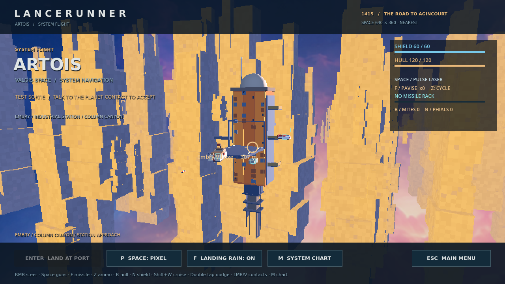
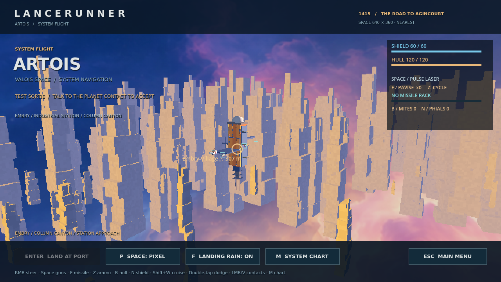

# Embry column canyon

Embry now has its own visual profile: long, rectangular asteroid columns with
stepped ledges, narrow fractures and broken crowns. Golden faces, blue shaded
planes and distance haze give the field an illustrated canyon appearance while
retaining the existing pixel-rendered space view.

The original **Embry Village** navigation target is now represented by a tall
orange industrial station, with a low-poly dome, patchwork panels, observation
balconies, antennae, hanging service structure and a front cargo platform. Several
large columns flank and back the tower so it sits among the rock formations.

## Gameplay preserved

- The station stays at its original map/world coordinates and keeps its ID.
- Embry retains 220 field instances: 64 tall primary columns and 156 smaller
  upright fragments. The total across Artois remains 780 instances in three fields.
- Central and Maroeuil fields retain their existing spherical-rock style.
- The traffic harbour remains at station-local `(0, 20, 95)`, above the front pad.
- Procedural columns reserve clearance around the station and straight approaches
  from the local ports and filament endpoints used by traffic routing.
- Selection tests instance bounds rather than enormous height-based spheres, so
  tall rocks do not intercept clicks through empty space around the station.

This is a visual environment pass. Embry does not acquire a new landing scene,
shop interior or docking action. As elsewhere in the current blockout, the rocks
and station do not have physical ship collision/damage. The clearances support
navigation and visual approaches rather than a new rigid-body obstacle system.

## Files

- `data/artois.json`: Embry's `column_canyon` profile, primary-column count and notes.
- `scripts/artois/artois_embry.gd`: seeded column mesh/placement, approach reserves
  and station geometry. The rocks use one MultiMesh; station boxes are batched
  into a multi-surface mesh with a separate dome.
- `shaders/artois/embry_stone.gdshader`: discrete mineral patches, warm/cool face
  colours and distance haze. No generated texture assets are required.
- Existing Artois world/picking code selects this profile only for Embry.

## Checks and previews

```sh
godot --headless --path . --script res://tests/artois_embry_smoke.gd
godot --path . --script res://tests/artois_embry_smoke.gd -- \
  --capture-dir=/absolute/path/to/captures
```

Checks cover column heights/counts, station profile and coordinates, all approach
reserves, unchanged harbour position, a completed merchant delivery, station
selection and rendered materials. Existing Artois and local-traffic checks also
pass. Verified on Godot 4.6.3 headless and OpenGL Compatibility; Forward+, Godot
4.7 and target hardware performance remain unverified.




