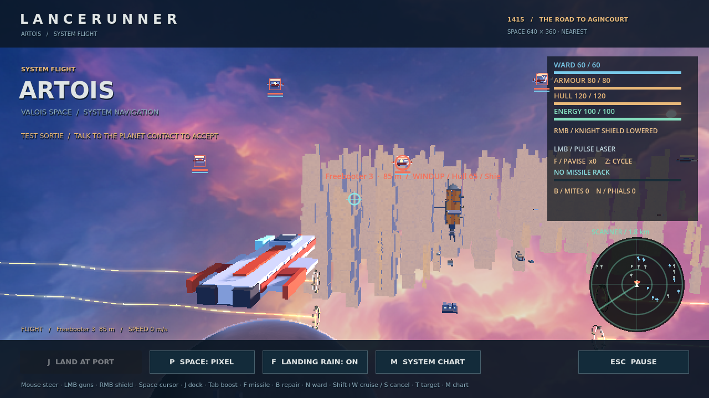

# Readable enemy tactics

Quest freebooters and ambient pirates/raiders now share `artois_fighter_brain.gd`.
Merchant delivery, salvage, civilian flight, names and faction targeting remain
in the existing traffic system. This is a bounded combat controller, not a new
strategic simulation or navigation mesh.

A fighter approaches a staging position, then commits through these phases:

1. **Windup:** 0.95 seconds for freebooters or 0.75 for raiders. The nose glows and
   the ship brakes, giving the player time to act.
2. **Attack run:** a committed course with a two-round burst. Guns remain within
   a 30-degree forward arc; the run ends after about two seconds or at close range.
3. **Break away:** disengage for 1.5 seconds, using afterburner if aligned and power permits.
4. **Recover:** reposition for 1.6 seconds before another approach. The ship can
   raise its forward guard if threatened, leaving its rear vulnerable.

At most two fighters per target may be winding up or running an attack at once.
Other fighters stage at different flank positions and altitudes. Attack slots
are released during breakaway/recovery, so another pair can press the attack.
This is simple coordination, not formation pathfinding or collision avoidance.

Targets are observed every 0.4 seconds by pirates and 0.25 by raiders. Aim uses
partial velocity lead plus small, deterministic error. Turning is bounded to
70 degrees/s, reduced to 18% in cruise. Incoming rounds must be nearby and in the
fighter's forward awareness before provoking a dodge, with a 0.35–0.47 second
reaction delay. Dodges use the same burst and decay as the player but are chosen
no more often than every 3.2 seconds. Committed runs deliberately expose openings.

Power capacity, recharge delay, regeneration, afterburner cost and directional
shield blocking use the player's defence component. Each successful gun shot
costs 12 power; bullets inherit ship velocity. Normal flight is capped at 35 m/s,
afterburner at 105, cruise at 175 after the same 1.8-second spool. Transit locks
guns/guard, and disruption cancels cruise/dodge and caps speed at 12. Fighters
hold fire when the planet or another hostile ship blocks the shot.

Freebooters have less accurate aim and retreat below 25% hull; raiders keep tighter
bursts/aim and retreat below 18%. Retreats are temporary, not instant escapes or
removal from the mission. NPC authored hull/passive-ward values are unchanged;
this pass adds no NPC armour or shield regeneration. Raider affiliation remains
concealed in the contact HUD. Pirate/raider and quest projectile damage remain
22/26 respectively at 110 m/s relative to the firing ship.

Ambient NPC hits now pass their incoming position to the player's shield, so
RMB blocks work against local attackers. NPC-to-NPC impacts also apply the round's
actual damage instead of the old fixed six-point value.

Validation: nine headless suites passed (tactics, mission combat, local traffic,
ordnance, knightly combat, mouse controls, highways, directional lanes and system
navigation). The tactical suite also passed rendered OpenGL Compatibility on
Godot 4.6.3. It checks full duel phases, actual gun arcs/velocity inheritance,
energy, reaction delay, physical dodge, directional block/rear damage, cruise and
Fetter limits, wounded retreat, squad commitment cap, planet line of sight and
hidden raider affiliation. Mission hit tests lead moving opponents and allow time
for telegraphs; they still destroy enemies using actual equipped projectiles.
Godot 4.7 Forward+ and hands-on combat balance remain unverified.

