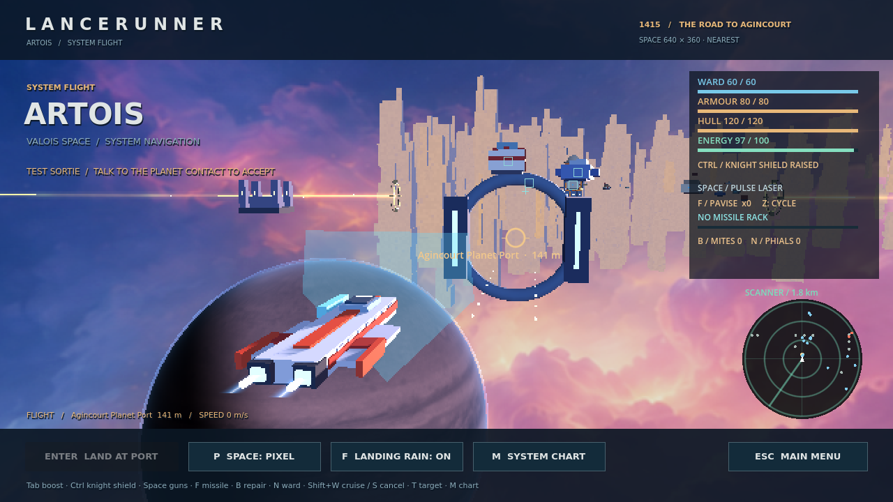
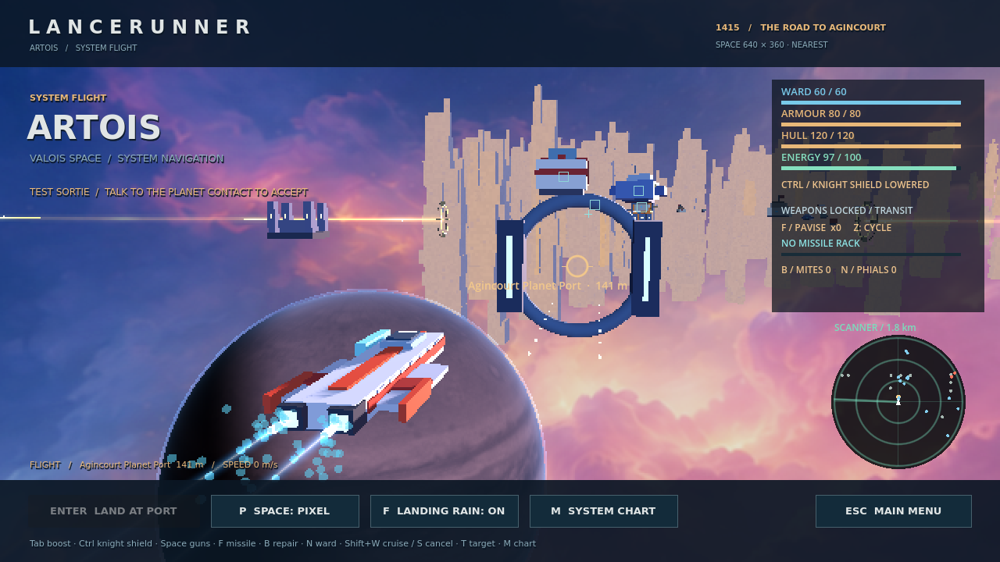

# Artois knightly combat pass

Artois now combines slow, damaging projectiles with dodge, a shared power reserve,
physical armour and a player-raised forward shield. Original ShipWars modes keep
their existing controls and combat.

| Control | Action |
| --- | --- |
| Shift+W or C | Start 1.8-second cruise spool; engine particles build before 175 m/s cruise |
| S, C, X | Cancel cruise or its spool (X also brakes) |
| Tab (hold) | Afterburner, up to 105 m/s, consuming 25 energy/s |
| RMB (hold) | Raise the directional knight shield |
| T | Cycle system destinations, patrol enemies and nearby local ships |
| Y | Align with selected target |
| LMB | Fire fitted primary guns within the existing cursor firing arc |
| Double-tap W/S/A/D/Q/E | Existing local-direction dodge; no energy cost |
| B / N | Armourer's Mites / Ward Phial |

Cruise reduces mouse steering sensitivity to 18%. Spooling and cruise lock guns,
missiles and active guard. Disruption, docking, navigation, dodge and filament
capture cancel pending cruise. Tab plus a direction escapes the golden highway;
Shift+W and double-tap escapes remain supported.

Power capacity is 100. Pulse rounds cost 12 energy, deal 48 damage and travel at
125 m/s; autocannon rounds cost 6, deal 24 and travel at 165 m/s. Cooldowns are
0.38 and 0.16 seconds. Failed/cooling-down shots consume no power. Energy recovers
at 18/s after 0.75 seconds without spending. Exhausted afterburner requires a Tab
release before restarting. Missiles cost 12 energy on successful launch and retain their paid ammunition and lock system.
Patrol rounds now travel at 110 m/s and deal 26 damage; local attackers deal 22.
These are initial tuning values; playtesting remains necessary for combat feel.

Holding RMB blocks 95% of hits arriving within a 120-degree cone centred on mouse aim.
Upkeep costs 14 energy/s, plus 0.45 energy per blocked damage point. Insufficient
power limits the amount blocked; an exhausted guard drops. The visible heater
shield follows the pointer, so rear and flank attacks remain dangerous. Guns may
fire while guarding, competing for the same reserve.

Remaining damage reaches the passive regenerating ward, then 80 points of
non-regenerating armour, then 120 hull. Existing anti-shield/hull missile profiles
are preserved before the armour layer. Armourer's Mites (180 credits) restore
60 hull and 40 armour, including when only armour is damaged. Docking fully
repairs and recharges. NPC armour/loadouts are unchanged in this player combat pass.

The bottom-right 1.8 km scanner shows heading-relative contacts: red hostiles,
blue locals, muted fixed destinations and gold selection, with altitude ticks.
It ignores mouse input. Chart/modal/landing states stop player power spending;
chart also lowers the guard. Health/power remain sortie state, not a new save format.

Implementation: `artois_ship_defence.gd` owns power, armour, block math and visuals;
`artois_scanner.gd` owns scope projection/drawing. Combat, flight and HUD call these
components. `tests/artois_knightly_smoke.gd` exercises power exhaustion/recharge,
cruise spool/cancellation, physical controls, forward/rear blocks, armour overflow,
modal pause, scanner rotation and a real projectile dodged versus stationary hit.

## Validation and previews

Godot 4.6.3 headless checks passed: `artois_knightly_smoke`, `artois_smoke`,
`artois_combat_smoke`, `artois_ordnance_smoke`, `artois_highways_smoke` and
`artois_traffic_smoke`. The knightly smoke also passed with rendered OpenGL
Compatibility, including physical Tab/T/S/RMB inputs and chart pause. Forward+
on the project's declared Godot 4.7 target was not available here.

The latest [mouse flight guide](mouse-flight.md) describes Space free cursor, J docking and the Escape pause menu.
