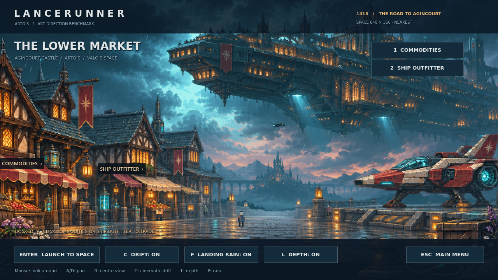
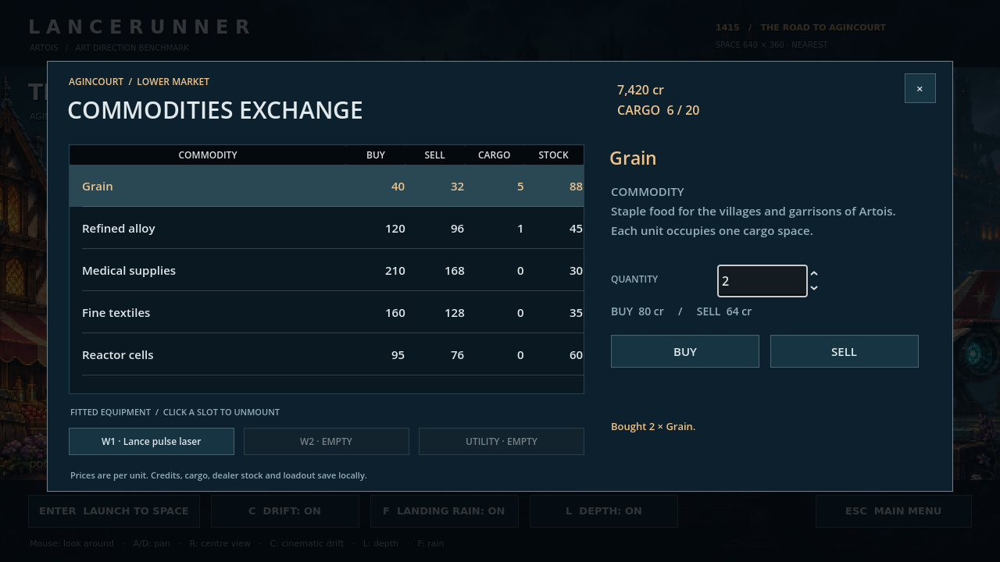
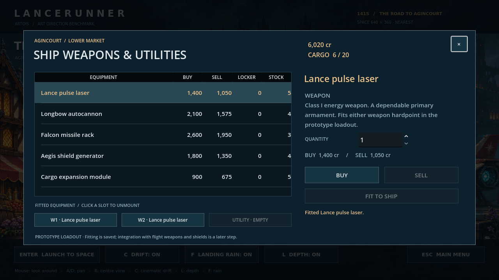

# Agincourt market shops

Land in the visual benchmark and click **COMMODITIES** or **SHIP OUTFITTER** on
the market buildings. Their hover targets and labels follow the market artwork's
parallax position. Fixed service buttons and keys **1 / 2** provide access when a
narrow window crops a building out of view.

## Commodities exchange

Select a commodity, set the quantity and choose **BUY** or **SELL**. The panel
shows the dealer's fixed unit prices, your cargo, available stock, credits and
cargo usage. The preview starts with 7,500 credits, three grain and one refined
alloy, occupying four of twenty cargo spaces. Medical supplies, textiles and
reactor cells are also available.

Transactions validate funds, stock, quantities, cargo capacity and ownership
before changing any balances. Sell prices are lower than buy prices. Dealer
stock changes with trades; this is a fixed-price local market, not a simulated
supply/demand economy.

## Weapons and utilities

The outfitter sells three weapons, five consumable supplies, a shield generator and a cargo expansion
module. Purchases enter the equipment locker. **FIT TO SHIP** mounts a stored
weapon in a free hardpoint or a utility in the utility slot. Click a fitted slot
to unmount into the locker; equipment must be unmounted before it can be sold.

The cargo module adds ten market cargo spaces while fitted and cannot be removed
until cargo fits the base hold. There are two weapon hardpoints and one utility
slot, with one starting pulse laser mounted.

**Artois uses this saved loadout in combat.** Closing the outfitter or launching
applies both weapon hardpoints and the utility. Aegis upgrades the built-in shield
from 60 to 180 and regeneration from 8 to 22 per second. The original visual
benchmark and original combat missions retain their separate mechanics.
The cargo module affects the market capacity checks.

Missile rounds (Pavise, Bodkin, Fetter), Armourer's Mites and Ward Phials are
stored in dedicated supply bins and cannot be fitted into equipment slots.
See [ordnance and supply prices](artois-ordnance.md). Existing ten-item saves
load without losing player state; new dealer supply stock is added automatically.

## Modal input and persistence

Opening a shop holds the landing camera still while ambient life continues.
**Esc** or **×** closes the shop. Launch, view shortcuts and menu navigation are
blocked behind the panel, so a quantity entry cannot launch the ship. The panels
use the benchmark's fitted logical UI layout when the window resizes.

Successful transactions/fitting changes save to
`user://lancerunner_market_preview_v1.json`, separate from the original combat
mission's score and health. The save includes credits, cargo, locker, fitted
slots and dealer stock. Data is validated before loading; whole-number JSON
values are normalised to integers. Writes use a temporary file and rename. A
save failure is reported in the panel while preserving the current in-memory
transaction. No reset button silently discards a profile.

## Structure and checks

- `landing_market_state.gd`: fixed catalog, transactions, fitting and save validation.
- `landing_shop_hotspots.gd`: world-aligned hit targets, including aspect-cover cropping.
- `landing_shop_panel.gd`: shop selection, trade controls and fitted-slot UI.
- `artois_visual.gd`: modal routing, camera hold and service entry points.

```sh
godot --headless --path . --script res://tests/market_smoke.gd
```

The headless check covers transactions, failure atomicity, cargo/fitting limits
and valid/invalid save loading. A rendered run additionally sends actual GUI
input to the panned shops, tests camera hold and Esc/launch handling, exercises
resized-window access and can save captures:

```sh
godot --path . --script res://tests/market_smoke.gd -- \\
  --capture-dir=/absolute/path/to/captures
```








Artois now provides [station-specific interiors and regional quotes](station-markets.md).
The player inventory is shared, while each visited dealer keeps independent saved stock.
