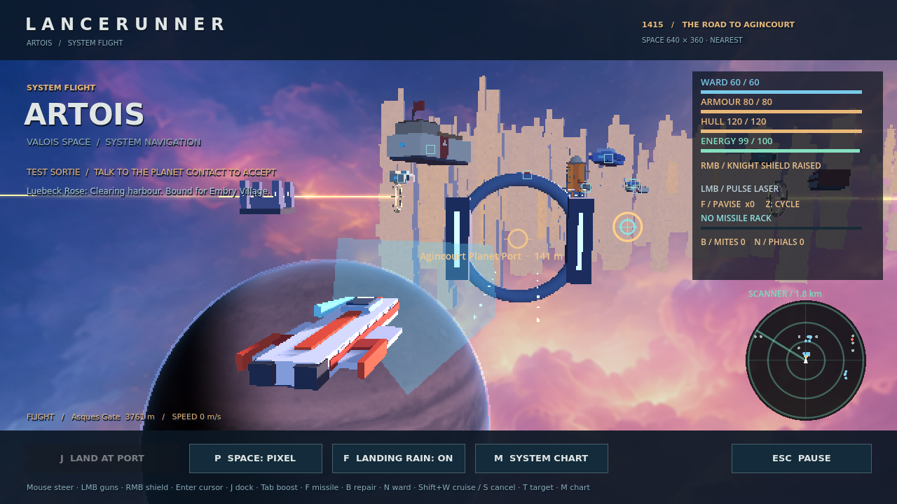
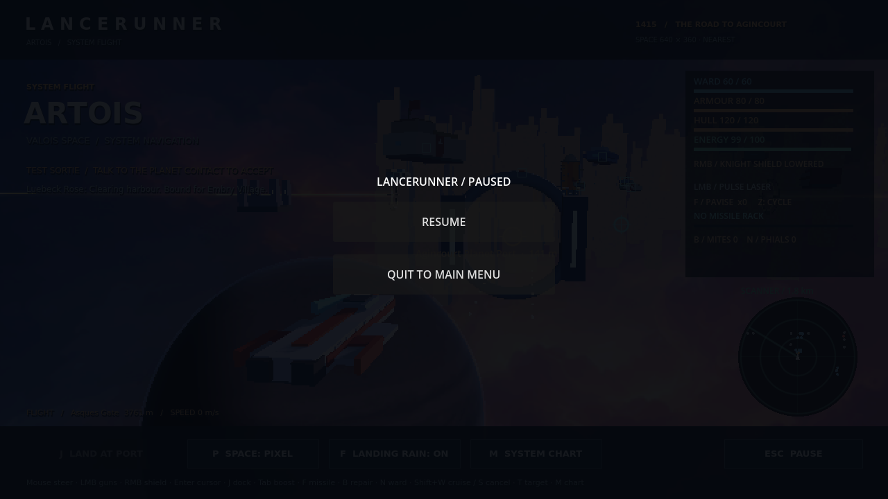

# Mouse flight, pause and NPC cruise

Default Artois flight now uses a hidden OS cursor and a larger aim reticle.
Move the mouse to steer toward the pointer, hold **LMB** for guns and hold **RMB**
for the knight shield. The gun keeps its existing 30-degree firing arc. The
shield follows the unclamped pointer direction, with a gold aim ring while
raised; its 120-degree blocking cone follows that direction instead of the nose.
Energy, upkeep, impact drain and rear vulnerability remain unchanged.

**Space** toggles a visible free cursor: mouse steering, guns and active guard
are disabled, and LMB selects objects or operates UI. WASD/QE movement remains
available. Space returns to flight and centres the cursor. **J** or **Enter** docks in space;
Enter still launches while landed. Tab remains afterburner, T cycles targets.
Autopilot continues with a stationary pointer; moving the mouse in flight cancels it.

**Escape** closes the current chart/shop/conversation first. Otherwise it opens
an in-game menu with **Resume** and **Quit to Main Menu**. Escape again resumes.
The menu pauses player flight, power, local traffic and encounter combat, including
when landed. Returning to the main menu requires the explicit quit action.

Exhaust ribbons fade with actual speed and stop generating samples while stopped.
Engine flames disappear at rest and lengthen with speed. Cruise spool particles
remain visible during charging even while stationary. Existing visual benchmark
calls retain their previous exhaust behaviour.

Local ships no longer flee at an immediate fixed 125 m/s. They first charge for
the same 1.8 seconds as the player, limited to normal thrust, then accelerate up
to 175 m/s with slower cruise turning. Local normal flight is capped at 35 m/s;
filament routes retain their distinct 350 m/s transport mode. Disruptors cancel
NPC spool/cruise and enforce the existing 12 m/s limit. Quest patrol interception
also spools and cannot fire during charge/cruise. Locals retain their role-specific
health, loadouts and routines; this does not add NPC dodge or shield AI.

Validation: `artois_mouse_smoke.gd` covers physical LMB/RMB/Space/Escape, free-cursor
selection, pause/resume/explicit quit, pointer-directed blocks, stationary versus
moving exhaust and civilian spool/disruption. Existing knightly, combat, ordnance,
traffic, navigation and highway smoke checks cover regressions. Rendered checks
use Godot 4.6.3 OpenGL Compatibility; Forward+ on declared Godot 4.7 remains untested.

