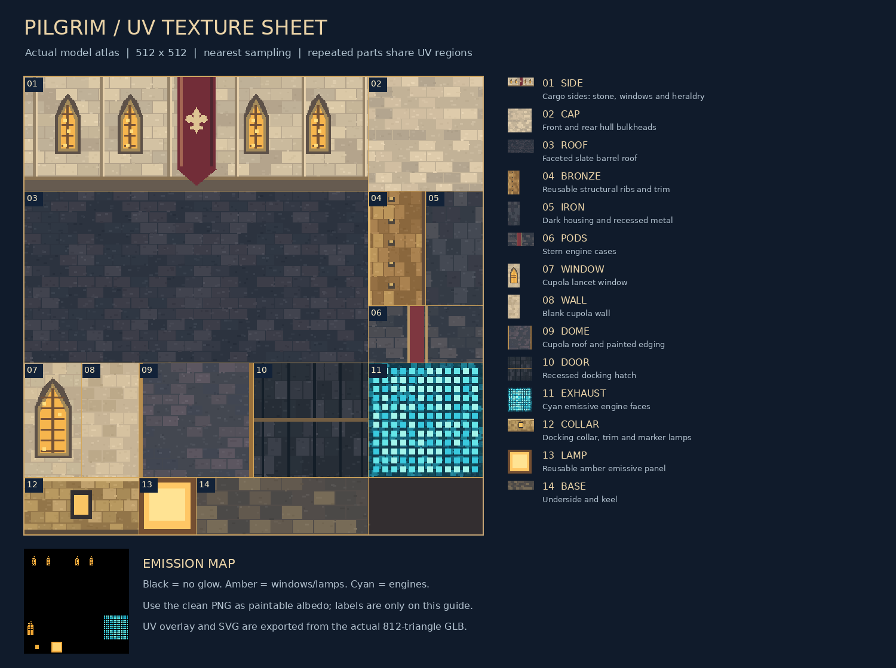
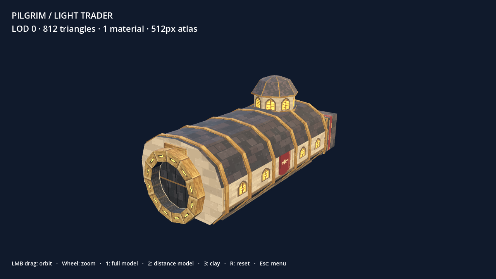
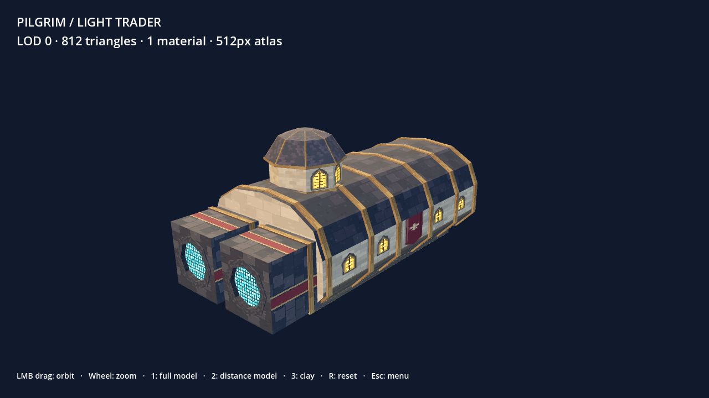

# Pilgrim light trader: actual model and texture sheet

The Pilgrim now has a real UV-mapped model, not just concept art. Pull `main`, run
Godot and choose **PILGRIM / MODEL PREVIEW** at the top right of the main menu.
You can also open `scenes/ships/pilgrim_preview.tscn` and press F6.

Drag LMB to orbit, wheel to zoom, 1 for the main mesh, 2 for its cheaper distance
version, 3 for clay shading, R to reset and Escape to return to the menu. The
asset is packaged separately; existing NPC population models are unchanged.

| Asset | Details |
| --- | --- |
| `assets/models/pilgrim/pilgrim.glb` | 812 triangles; one mesh/material surface |
| `assets/models/pilgrim/pilgrim_lod1.glb` | 341 triangles; one mesh/material surface |
| `assets/models/pilgrim/source/pilgrim_source.blend` | Editable named components, packed images, studio camera |
| `assets/textures/pilgrim/pilgrim_albedo.png` | Clean paintable 512×512 colour atlas |
| `assets/textures/pilgrim/pilgrim_emission.png` | Matching glow map: black off, amber windows, cyan engines |
| `docs/pilgrim-model/pilgrim_uv_layout.svg` | Real exported UV edges, transparent SVG |
| `docs/pilgrim-model/pilgrim_uv_overlay.png` | Transparent 512×512 overlay for a paint editor |
| `docs/pilgrim-model/pilgrim_texture_guide.png` | Numbered atlas regions and material legend |

This is a **shared-region atlas unwrap**. Repeated ribs, trim, windows and engine
faces reuse the same patches, keeping texture and material costs down. Painting
one reused patch changes all faces using it. The guide's labels are separate from
the clean albedo. The UV overlay uses a top-left image origin, matching the glTF
texture coordinates. Keep canvas dimensions and patch boundaries unchanged when
painting. Repainting the colour sheet does not automatically alter the glow map;
edit the matching emission region if a glowing window or engine shape changes.

Both Godot imports remap to `pilgrim_material.tres`, sharing the same two atlas
images. Filtering is nearest with mipmaps to preserve crisp close detail and
reduce distant shimmer. The GLBs also embed their own images/material for use
outside Godot. The editable `.blend` lives under `.gdignore`, so loading the Godot
project does not require Blender to be installed.

The ship faces **-Z** in Godot/glTF. Approximate bounds are **9.28 m wide × 9.65 m
high × 21.25 m long**. Named engine, docking collar and cockpit mounts are included.
The hull, six structural ribs, faceted cupola, hollow bow collar and recessed twin
engine openings are geometry; stone joints, heraldry and window tracery are painted.
No rigid-body collision, flight controller or automatic simulation-distance system
is added to this asset. The cheaper mesh is ready for later LOD integration.

Regenerate geometry/atlases/source/GLBs with Blender 4.3+:

```sh
blender --background --python tools/assets/build_pilgrim.py
python tools/assets/export_pilgrim_uv.py
```

The UV-guide exporter requires Pillow; Blender's builder uses its own raster code
and needs no Pillow installation. Texture art is authored by the builder, guided
by the Pilgrim concept; hidden surfaces were designed rather than recovered from
the concept image. Rebuilding overwrites the generated model and PNGs, so keep any
hand-painted changes in a working copy or adapt the builder first.

Validation: the model smoke suite verifies real triangle counts, one surface per
LOD, shared material, texture/emission maps, outward-facing exhaust geometry,
world orientation, manifest dimensions, clay/LOD switches and main-menu roundtrip.
It passes headless and rendered OpenGL Compatibility in Godot 4.6.3. Godot 4.7
Forward+ and fleet-scale performance remain untested.





[Download the texture pack](pilgrim-model/pilgrim-texture-pack.zip): clean colour
and emission PNGs, transparent UV overlay, SVG layout and labelled guide.
