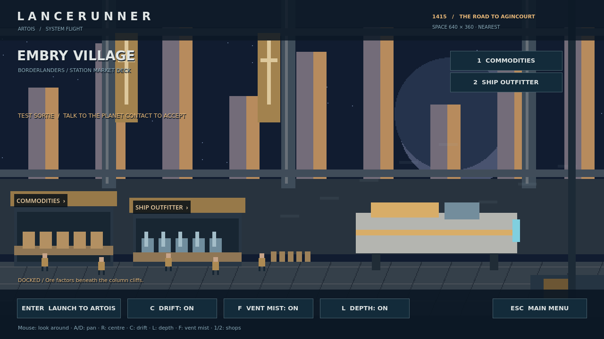
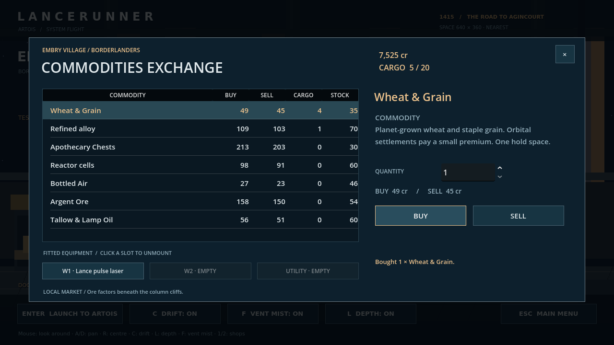
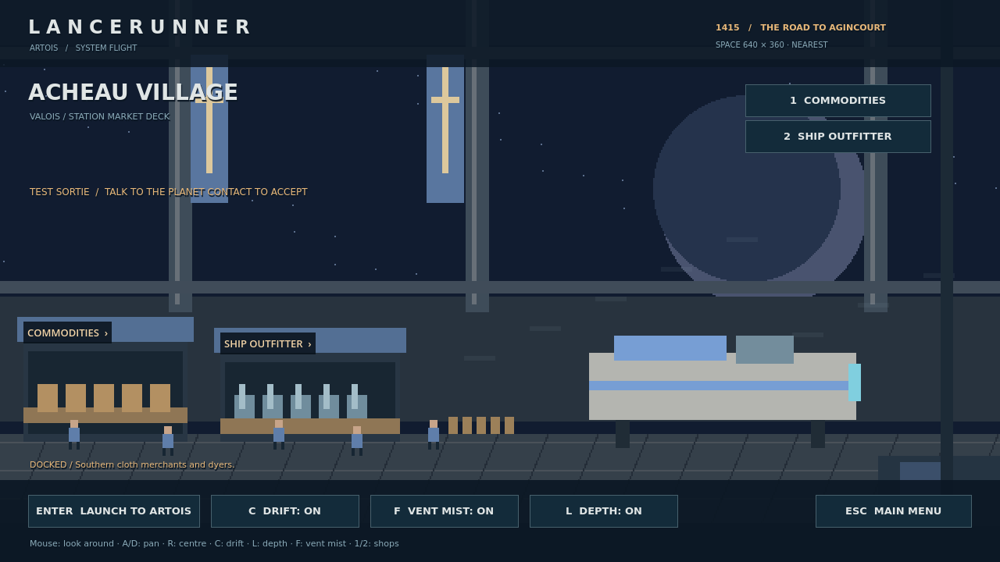
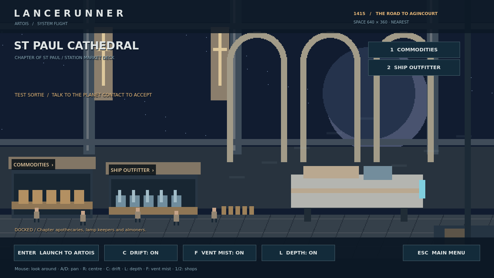

# Station landings and local trade

Artois has **14 dockable ports**: the existing planet market and thirteen station,
ship-tender or salvage-camp interiors. Select a port, use G to approach, and press
**Enter** within **90 m** and below **20 m/s**. Enter launches outside that same
port. Stations launch facing out from their approach; the original planet launch
behaviour is retained.

Every port has **COMMODITIES** and **SHIP OUTFITTER** counters. Click them in the
parallax scene, use the service buttons, or press **1 / 2**. Open shops block
launch. Fluellen and his contract remain on the planet only.

## Ports and specialities

| Port | Provisional market affiliation | Role |
| --- | --- | --- |
| Agincourt Planet Port | Borderlanders | Wheat, airworks, rendering oils; imports refined/rare metals |
| Border Post | Britannian | Garrison provisions; demand for cloth and medical stores |
| Renty | Britannian | Wool factors and weaving sheds |
| Embry | Borderlanders | Mining; cheap argent ore and refined metal |
| Caulers | Hanseatic League | Counting house, freight exchange and ale |
| Agincourt Castle | Border Garrison | Fortress victuallers and quartermasters |
| Fressin | Borderlanders | Salvage enclave inside the ruined castle |
| Wrecked Shipyard | Borderlanders | Recovered alloy, ore and workshop supplies |
| Old Merchant Guild | Hanseatic League | Surviving counting house among the ruins |
| Freebooter Base | Freebooters | Unlicensed barter deck |
| Acheau | Valois | Cloth merchants and dyers; demand for northern wool |
| Southern Outpost | Valois | Garrison supply market |
| Southern Capital Ship | Valois | Fleet tender and armourer's counter |
| St Paul Cathedral | Chapter of St Paul | Apothecaries, lamp keepers, brewing and plate demand |

These profiles are editable demo content rather than final political/story
ownership decisions. Hyper gates, Asques Gate, Arras's ruined gate and the bare
Maroeuil wreck do not open shops. Ruined stations with market profiles use
makeshift salvage enclaves rather than pretending their original facilities
are intact. There is no new explanation for the system closure.

## Trade goods and modest runs

Existing inventory IDs are retained: grain is displayed as **Wheat & Grain**,
textiles as **Fine Broadcloth**, and medicine as **Apothecary Chests**. New cargo
includes **Bottled Air**, **Wool Bales**, **Argent Ore**, **Ale Casks** and
**Tallow & Lamp Oil**. Each unit uses one cargo space.

| Buy at | Sell at | Good | Buy / destination bid | Profit per unit |
| --- | --- | --- | --- | --- |
| Planet | Embry | Wheat & Grain | 40 / 45 cr | 5 cr |
| Planet | Embry | Bottled Air | 20 / 23 cr | 3 cr |
| Embry | Planet | Argent Ore | 158 / 174 cr | 16 cr |
| Shipyard | Planet | Refined alloy | 106 / 116 cr | 10 cr |
| Renty | Acheau | Wool Bales | 54 / 59 cr | 5 cr |
| Acheau | Border Post | Fine Broadcloth | 148 / 157 cr | 9 cr |
| Caulers | Southern Capital Ship | Ale Casks | 29 / 33 cr | 4 cr |
| St Paul | Agincourt Castle | Apothecary Chests | 190 / 207 cr | 17 cr |
| Planet | Agincourt Castle | Tallow & Lamp Oil | 48 / 53 cr | 5 cr |

The destination bid is what its dealer pays the player. Buying and selling at
one market always loses money. Local price spreads are intentionally small;
the short wheat/air runs offer gentle profits, while more expensive metal or
medical cargo ties up more credits. Outfitter equipment and consumable prices
remain the same at every port.

Commodity availability differs too. Unsupported goods are not offered, although
owned unsupported cargo remains visible with an explanation that the local
dealer does not trade it. Ship capacity, funds and dealer-stock checks apply
before every transaction.

## Stock and saves

Each visited port has its own stock dictionary. Switching venues cannot reset
or copy another dealer's stock. Stock, credits, cargo and fitted equipment save
in the existing local inventory file; old single-market saves migrate to the
planet market and gain the new catalogue without losing player state.

Prices are fixed profile data. Stocks are finite and change through player
transactions; there is no timed restocking or NPC supply/demand economy in this
pass. NPC routines continue as before and do not silently alter quoted prices.
Full campaign/location saving is still separate: a fresh Artois session starts
at the planet approach rather than reopening the last station interior.

## Placeholder interiors

Every station has its own small `.tscn` resource under `scenes/stations/`, using
a shared configurable `station_landing.tscn`. Six native 640×360 layers provide
windows, structure, moving background traffic/vapour, counters, dockworkers and
foreground props. Faction colours and mining/salvage/chapel details distinguish
markets. These are procedural blockout plates, ready for replacement by authored
2.5D artwork. The existing painted planet scene is preserved.

Mouse movement/A/D pan, R centres, C toggles drift, L toggles depth, and F toggles
interior vent mist. Shop hotspots follow the market layer through cropping and
parallax. The scene cache retains planet/station interiors across local visits.

Content and code:

- `data/artois_markets.json`: dockable IDs, themes, affiliation, local quotes and stock overrides.
- `artois_markets.gd`: market catalogue and scene-path lookup.
- `landing_market_state.gd`: venue quotes, shared inventory, isolated stock and compatible persistence.
- `artois_station_landing.gd` / `artois_station_layer.gd`: parallax interior blockouts.
- Artois world/coordinator: docking selection, cached interiors, shop context and local launch.

Include **`data/*.json`** in exports. The same raw-data requirement now covers
system layout, local population and markets.

## Validation

```sh
godot --headless --path . --script res://tests/artois_station_markets_smoke.gd
godot --path . --script res://tests/artois_station_markets_smoke.gd -- \
  --capture-dir=/absolute/path/to/captures
```

Tests check sample route profits, no same-port arbitrage, availability, stock
isolation, multi-port save/load, old-save migration, every docking/interior/shop/
launch flow, planet-only contact and non-dockable gate/wreck behaviour. Rendered
checks also click the station counter and buy using its actual local price.
Existing market, navigation, combat and ordnance checks pass. Verified on Godot
4.6.3 headless and rendered OpenGL Compatibility; Forward+, Godot 4.7 and target
hardware performance remain unverified.








