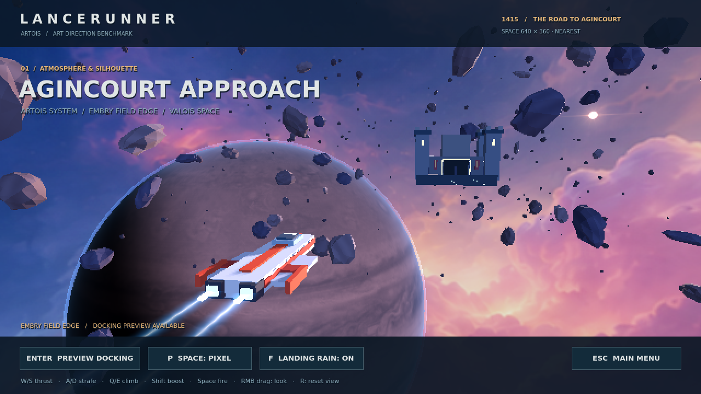
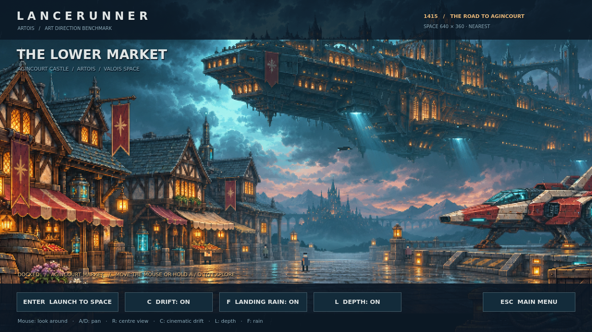

# Artois visual benchmark

An isolated art-direction test for Lancerunner: low-resolution 3D space flight,
a docking fade and a layered 2D landing location. It is an art blockout, not the
Artois map, a docking mechanic or a replacement for the existing combat game.
The scene introduces no dependencies on the separate player/HUD refactor.

## Rendered previews

These are captures of the runnable Godot scene using the software OpenGL renderer,
not concept art or a claim of final production artwork.





[Watch the recorded parallax preview](benchmark-previews/landing-parallax.mp4).

[Compare the native-resolution space capture](benchmark-previews/artois-space-smooth.png).

## Open it

Open the project in Godot and select **ARTOIS / VISUAL BENCHMARK** on the main
menu. Alternatively open `scenes/benchmark/artois_visual.tscn` and press F6, or:

```sh
godot --path . res://scenes/benchmark/artois_visual.tscn
```

- **W / S:** forward / reverse thrust.
- **A / D:** strafe; **Q / E:** descend / climb.
- **Shift:** faster thrust; **Space:** fire visual-only weapon bolts.
- **Enter**, or the docking button: fade into the landing scene / launch back.
  This is available anywhere for comparison; proximity and docking AI are not implemented.
- **P:** compare 640×360 nearest-filtered space rendering against native-resolution
  space rendering with anti-aliasing. Interface text remains independently rendered.
  Landing art keeps its own 640×360 pixel grid in both modes.
- **F:** toggle landing rain and mist.
- **Right mouse drag:** orbit the space camera; **R:** reset its view.
- **Landed:** mouse look and **A / D** camera pan; **R** recentres.
- **C / DRIFT:** cinematic camera drift; **L / DEPTH:** parallax comparison.
- **Esc:** return to the original main menu.

The space test uses bounded local movement; it has no collision, damage, targeting,
boarding, economy or persistent system simulation. No existing mission controls
or rules are changed.

## What to evaluate

1. Does the red-and-white ship read clearly against the pink/gold/blue nebula?
2. Are faceted rocks, the ship and the fortress station consistent at one pixel scale?
3. Which space rendering mode reads better during motion?
4. Do the warm landing lights and cool weather feel related to the space palette?
5. Is the docking transition convincing enough to justify separate landing artwork?

The space geometry remains an original procedural blockout. Landing art uses three
original generated plates with real alpha separation, inspired by the supplied
cinematic pixel-art and medieval science-fiction references. See the
[landing art and depth guide](landing-art.md). They do not embed or reproduce the attached
ship model or detailed city illustration. Production polish still depends on the
replacement artwork, animation, audio and subsequent lighting work.

## Replace assets

| File / node | Responsibility and replacement contract |
| --- | --- |
| `benchmark_space.gd` | Seeded asteroid composition, station blockout, camera and bounded movement. |
| `voxel_ship.gd` | Original red/white placeholder. Replace its box geometry with your model, preserving forward **-Z**, up **+Y**, and a roughly six-unit length. Keep `engines` as an array of nodes to animate, or leave it empty. |
| `landing_art_layer.gd` | Overscanned source artwork and non-destructive framing. |
| `landing_ambience.gd` | Bounded runtime traffic, mist, people, fire, rain and splashes. |
| `benchmark_landing.gd` | Six depth planes, camera easing, keyboard pan and depth/drift controls. |
| `assets/benchmark/landing/` | Opaque distant art plus transparent market and foreground PNGs. |
| `artois_visual.gd` | Viewports, readable UI, render comparison, transition and automated smoke check. |
| `space_effects.gd` | Bounded, short-lived world-space exhaust ribbons. |
| `assets/benchmark/artois_nebula.png` | Generated 2:1 LDR panorama, **1774×887**, not native 4K. See its adjacent README for provenance. |
| `shaders/benchmark/` | Panorama wrapping, textured planet, atmosphere shell, depth-tested sun corona, rock haze and exhaust. |

The landing view is composed on a **640×360** logical canvas. Current generated
source plates are **1672×941**, drawn into overscanned framing rectangles. Give layers at least 16 pixels
of overscan at the sides and 8 at top/bottom for parallax. The sky must be opaque;
nearer layers should have transparent backgrounds. Keep key scene content clear
of the top 43 and bottom 53 pixels used by the interface. The preview is composed
for **16:9**, with exact 2× scaling at 1280×720 and 3× at 1920×1080. Other aspect
ratios fit the UI and crop the background; non-integer scaling is not pixel-perfect.

The space scene combines warm directional sunlight, cool fill, a large textured
planet with a separate atmosphere shell, 55 nearby rocks and 300 instanced distant
rocks, distance haze on the rocks, a depth-tested additive sun corona and bounded
blue-white exhaust ribbons. Boost also eases the camera's field of view outward.
The planet reuses the credited Solar System Scope Jupiter texture already in the
repository; see `assets/textures/CREDITS.txt`.

The generated nebula source is **1774×887**, even though 4K was requested. It is
a game-ready derivative of the approved image, with the same composition and
palette. Source pixels are not enlarged or relabelled as native 4K. The sky shader
crossfades the wrap region and blends pole colours; explicit texture LOD avoids
filtering artefacts at the longitude discontinuity. Source replacement is a single
texture assignment. See [asset provenance](../assets/benchmark/README.md).

On Forward+/Mobile, HDR glow is enabled at restrained intensity; it is not enabled
on Compatibility. The composition, sun corona and trails work without bloom or
volumetric fog. Forward+ glow remains unverified on this machine. The landing
view is 2D; it is not a walkable 3D town. Agincourt's architecture and Valois labels
are provisional art direction, not a final narrative/location specification.

## Checks and captures

```sh
godot --headless --path . --editor --import --quit
godot --headless --path . res://scenes/benchmark/artois_visual.tscn -- --benchmark-smoke
godot --headless --path . --script res://tests/benchmark_navigation.gd
```

The smoke mode checks movement, boost, firing, pixel/smooth rendering settings,
docking, layer alpha, depth/drift controls, pan bounds, shared actor/pavement
positions, weather toggles, camera orbit/reset, asteroid population,
nebula assignment, exhaust geometry/history bounds and returning to space. A rendered
run can also save PNG captures (requires a graphical display):

```sh
godot --path . res://scenes/benchmark/artois_visual.tscn -- \
  --benchmark-smoke --capture-dir=/absolute/path/to/captures
```

Inspect all six sky directions, including the wrap and poles, with:

```sh
godot --path . --script res://tests/skybox_review.gd -- \
  --capture-dir=/absolute/path/to/captures
```

Use `--rendering-method gl_compatibility` before the scene path for an OpenGL
fallback. Captures and local logs are not gameplay assets. Runtime checks use
Godot assertions, so run a debug/editor build. Software-rendered captures validate
the appearance and transitions, not performance on the intended player's GPU.

Validation environment: Godot 4.6.3, with rendered captures checked on Mesa
llvmpipe/OpenGL Compatibility. The project's declared version is 4.7. This
machine cannot initialise Vulkan, so Forward+ and hardware GPU performance
still need checking on the target computer. The existing combat scene also
launches; it emits an ObjectDB cleanup warning when stopped after ten frames.
